<div align="center">


<h1>Ostrov</h1>

<p><strong>A quiet island at the top of Windows.</strong><br>
Media, timers and agent progress live in one tiny, always-on-top pill.</p>

<p>
  <a href="downloads/Ostrov_1.2.10_x64-setup.exe"><strong>Download for Windows</strong></a> &nbsp;·&nbsp;
  <a href="downloads/Ostrov_1.2.10_x64-portable.zip">Portable .zip</a> &nbsp;·&nbsp;
  <a href="downloads/SHA256SUMS.txt">Checksums</a>
</p>

<p>
  <code>v1.2.10</code> &nbsp;·&nbsp; Windows 10 &amp; 11 &nbsp;·&nbsp; x64 &nbsp;·&nbsp; 12.7 MB &nbsp;·&nbsp; Tauri core
</p>

</div>

---



## Activity terrain

The site ships a small experiment: a GitHub-style contribution heatmap that stands up into a 3D terrain you can pick up. Every day is a column, its height is the day's count, and the whole board is drawn on a plain `<canvas>`.

- **Flat &harr; Terrain** — flip between the honest heatmap and the tilted view.
- **Drag, throw, settle** — orbit the board with the pointer; a flick coasts and slows, the edges rubber-band, a spring settles it back to rest.
- **Rise in waves** — columns grow outward from the day you grab, the far end lagging behind with a slight overshoot.
- **Hover / arrow keys** — any day lights up in orange and the readout names it.

**Live demo:** [ram-ft.github.io/Ostrov/activity.html](https://ram-ft.github.io/Ostrov/activity.html)

It is plain Canvas and math — no React, no Three.js, no dependencies. The effect is a port of [KokonutUI's Activity Terrain](https://kokonutui.com) by [@dorianbaffier](https://github.com/dorianbaffier) (MIT), re-implemented in vanilla JS. The data on the demo is generated deterministically.

## The landing page

A neo-brutalist single page for the app: paper background, 2&nbsp;px ink borders, hard offset shadows, and one loud orange accent.

- **Hero** — poster-style island art instead of a video demo.
- **Features** — a bento grid of the island's jobs: media, agents, focus, pinning, themes, native feel.
- **States** — the four shapes the island expands into, mocked at real proportions.
- **Specs, downloads, FAQ** — the boring parts, kept short.
- **Details** — marquee ticker, spec strip, container queries, reveal-on-scroll (guarded so content stays visible without JS), and full `prefers-reduced-motion` support.

Still hand-written HTML, CSS and JS. No framework, no build step.

## Repo map

| Path | What it is |
| --- | --- |
| `index.html` | Landing page |
| `styles.css` | All styles and design tokens |
| `script.js` | Nav state, scroll reveals, footer year |
| `activity.html` | Activity terrain demo page |
| `activity-terrain.js` | The Canvas port of the terrain effect |
| `demo/activity-terrain.svg` | Animated preview used at the top of this file |
| `assets/` | Mark and favicon |
| `downloads/` | Windows builds, v1.2.10 |
| `.github/workflows/static.yml` | GitHub Pages deploy workflow |

## Run locally

```sh
python -m http.server 8000
```

Then open <http://localhost:8000/> (or `npx serve .`). Everything is static, so opening `index.html` directly mostly works too — a server just keeps relative paths tidy.

## Deploy

Pushes to `main` deploy through the included GitHub Actions workflow. Pages has to be enabled once: **Settings &rarr; Pages &rarr; Source: GitHub Actions**.

## Credits

- **Activity Terrain** — [KokonutUI](https://kokonutui.com) / [@dorianbaffier](https://github.com/dorianbaffier), MIT. Ported to plain Canvas for this site.
- **Everything else** — hand-written for Ostrov.

Ostrov is not affiliated with Apple; "dynamic island" here refers to the interaction pattern.
